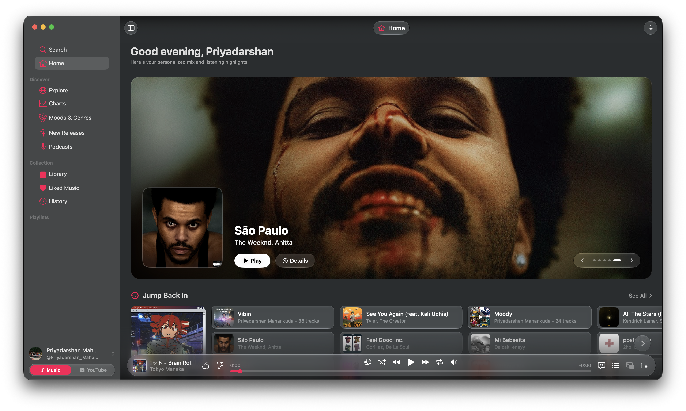
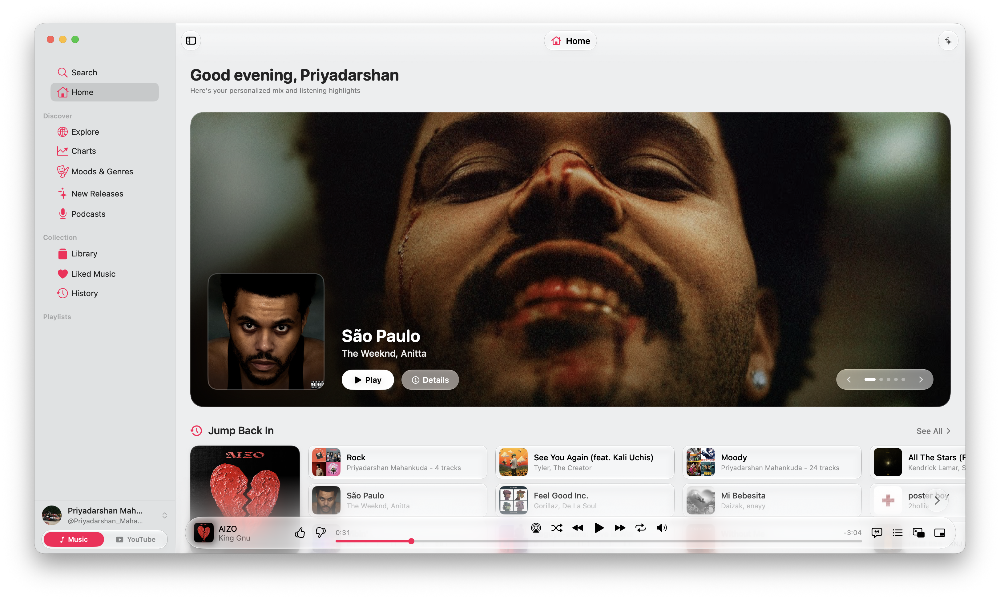
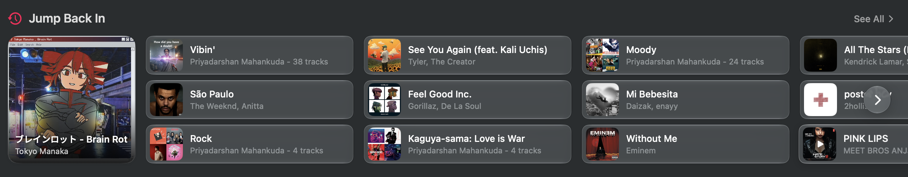
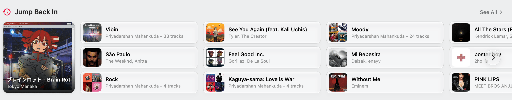
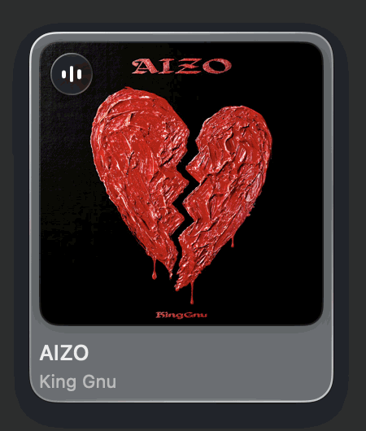
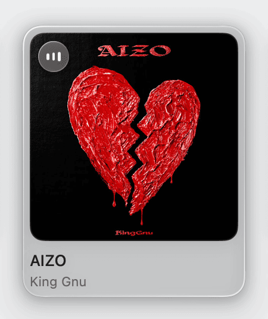
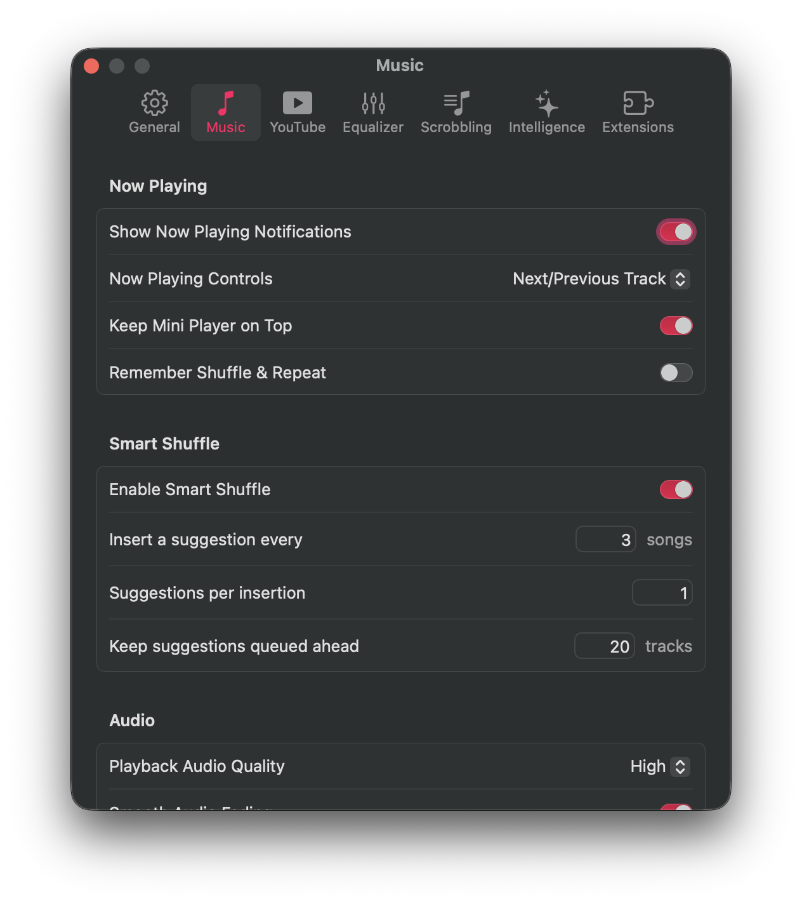
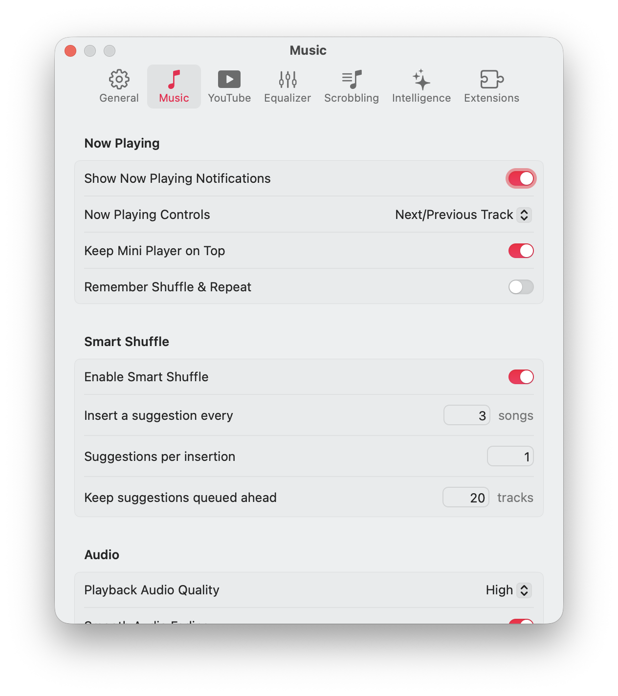

# Kaset

A native macOS client for YouTube Music and YouTube, built with Swift and SwiftUI.

---

## Video Demonstration

<p align="left">
  
</p>

> Full-resolution walkthrough video: [`docs/screenshots/kaset-homescreen-demo.mp4`](docs/screenshots/kaset-homescreen-demo.mp4)

---

## Design Evolution: Before & After

<table>
  <tr>
    <th width="50%">Previous Interface</th>
    <th width="50%">Redesigned Home Interface</th>
  </tr>
  <tr>
    <td></td>
    <td></td>
  </tr>
  <tr>
    <td valign="top">Standard flat list layout with basic grid carousels.</td>
    <td valign="top">Redesigned with a hero spotlight carousel, quick-resume Jump Back In shelf, animated audio visualizer, and macOS Liquid Glass styling.</td>
  </tr>
</table>

---

## Appearance Modes

<table>
  <tr>
    <th width="50%">Dark Mode</th>
    <th width="50%">Light Mode</th>
  </tr>
  <tr>
    <td></td>
    <td></td>
  </tr>
</table>

---

## Key Features & Design

### Spotlight Hero Stage
- **Dynamic Artist Backdrops**: Features high-resolution artist artwork with smooth edge fading that naturally blends into the app background.
- **Featured Carousel**: Quick access to your top rotations and mixes with one-click playback and seamless navigation to album or playlist details.

### Jump Back In Shelf
- **Recent Highlight Card**: Prominently showcases your most relevant recent session with full-bleed artwork.
- **Smart Click Actions**: Click the album art to start playing immediately (or restart from 0:00 if already active), or click the title to view the full album or playlist.
- **Quick-Pick Columns**: Clean 3-row track list with translucent hover highlights for quick listening.

<table>
  <tr>
    <th width="50%">Jump Back In (Dark Mode)</th>
    <th width="50%">Jump Back In (Light Mode)</th>
  </tr>
  <tr>
    <td></td>
    <td></td>
  </tr>
</table>

### Now Playing Platter & Audio Visualizer
- **Glass Platter Indicator**: The active song card gently elevates with a translucent glass border to clearly show what's currently playing.
- **Live Visualizer Badge**: An animated 3-bar audio visualizer pill in the top-left corner indicates active playback in real time.

<table>
  <tr>
    <th width="50%">Playing Card Platter (Dark Mode)</th>
    <th width="50%">Playing Card Platter (Light Mode)</th>
  </tr>
  <tr>
    <td></td>
    <td></td>
  </tr>
</table>

### Smooth Audio Fading
- **Natural Transitions**: Uses equal-power volume curves on play, pause, and skip to eliminate abrupt audio cuts.
- **Customizable Timing**: Adjust fade duration to your preference directly in the native Settings panel.

<table>
  <tr>
    <th width="50%">Audio Settings (Dark Mode)</th>
    <th width="50%">Audio Settings (Light Mode)</th>
  </tr>
  <tr>
    <td></td>
    <td></td>
  </tr>
</table>

### Floating Glass Topbar
- **Seamless Scroll Blur**: Content smoothly softens as it scrolls underneath the top navigation bar.
- **Adaptive Appearance Tint**: Dynamically matches macOS dark and light themes with native vibrancy.

<p align="left">
  
</p>

### Smart On-Device Recommendations
Kaset tailors your home feed and shelf recommendations using an on-device affinity engine. Everything is calculated **100% locally and privately on your Mac**—your listening habits and history never leave your device:

$$
S(x, t) = \max\left(0, \; (1 - D_x) \cdot \left[ 25 \sum_{k=1}^{n} w_k (\Delta t_k)^{-0.5} + 25 \left(25 \, I_{\text{playlist}} + 15 \, I_{\text{liked}}\right) + 0.4 \, A_{\text{artist}} + E_{\text{album}} - 10 \, N_{\text{skip}} \right] - 1000 \, D_x \right)
$$

- **Recency & Attention** ($B_i = \sum w_k (\Delta t_k)^{-0.5}$): Tracks you listen to completely receive higher weights than quick skips, while recent plays naturally decay over time ($\Delta t_k$ hours) to keep recommendations fresh.
- **Explicit Favorites** ($I_{\text{playlist}}, I_{\text{liked}}$): Adding a song to a playlist (+25) or liking it (+15) gives it an immediate priority boost across shelves.
- **Artist Affinity** ($A_{\text{artist}}$): Tracks from artists you frequently listen to receive a scaled boost across recommendations.
- **Smart Rotation**: Prevents your top tracks from permanently monopolizing the spotlight, rotating candidates across listening sessions.
- **Dislike Suppression** ($D_x$): Disliked songs or artists receive a strong penalty ($-1000$) to immediately remove them from all recommendations.

---

## Core Capabilities

- **High-Fidelity Playback**: Full streaming support for YouTube Music Premium and standard YouTube video feeds with background playback.
- **6-Band Equalizer**: Fine-tune your sound with built-in presets and manual frequency controls.
- **Time-Synced Lyrics**: Real-time line-by-line lyric tracking with on-device translation.
- **Smart Shuffle**: Intelligently mixes recommended tracks into your queue based on your taste.
- **Native macOS Integration**: Media keys, Control Center / Now Playing widgets, AppleScript automation, and Force Touch trackpad haptics.
- **Web Extension Support**: Native content blocking with support for uBlock Origin Lite and SponsorBlock.

---

## Build & Installation

### Requirements
- macOS 15.4 or later
- Xcode 16+ / Swift 6.0+

```bash
# Clone the repository
git clone https://github.com/httperry/Kaset.git
cd Kaset

# Build the project
swift build

# Package and run the native .app bundle
./Scripts/compile_and_run.sh --debug
```

---

## Credits & License

Kaset is an open-source native client.
- Built by [httperry](https://github.com/httperry) for Hack Club Macondo.
- Based on the upstream project by [Sertac Ozercan](https://github.com/sozercan/kaset).
