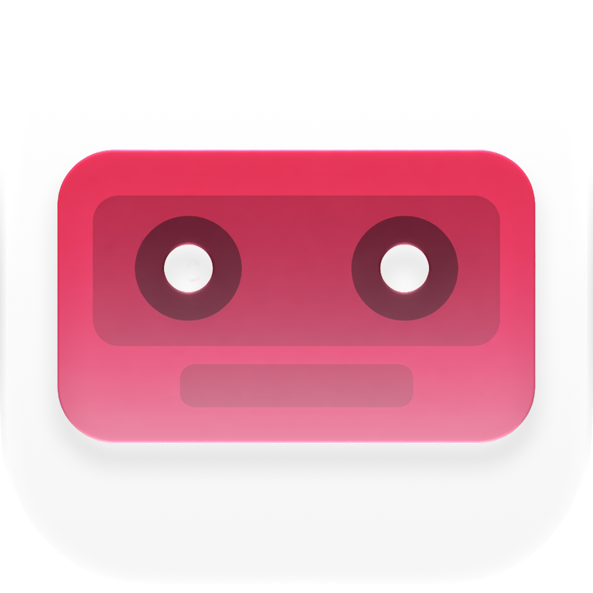
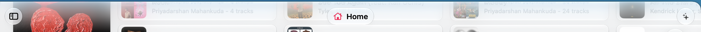

# Kaset — Floating Glass Topbar

A native macOS client for YouTube Music and YouTube with a modern floating translucent topbar.

---

## Overview

The previous topbar was a static, solid bar that abruptly cut off scrolling content. This update redesigns the top navigation into a floating glass bar that smoothly blurs album art and titles as you scroll underneath.

<p align="left">
  
</p>

---

## Key Features

- **Seamless Scroll Blur**: Content smoothly softens as it scrolls beneath the top navigation bar without harsh cutoffs.
- **Adaptive Theme Tint**: Automatically matches macOS light and dark modes with native translucency.
- **Native Window Alignment**: Perfectly spaces navigation pills and search controls alongside macOS window buttons.
- **Fullscreen Auto-Hide**: Hides navigation controls during full-bleed video playback, revealing them smoothly on hover.

---

## Building from Source

```bash
# Clone the feature branch
git clone -b topbar-fix https://github.com/httperry/Kaset.git
cd Kaset

# Build the project
swift build

# Package and run the app bundle
./Scripts/compile_and_run.sh --debug
```
